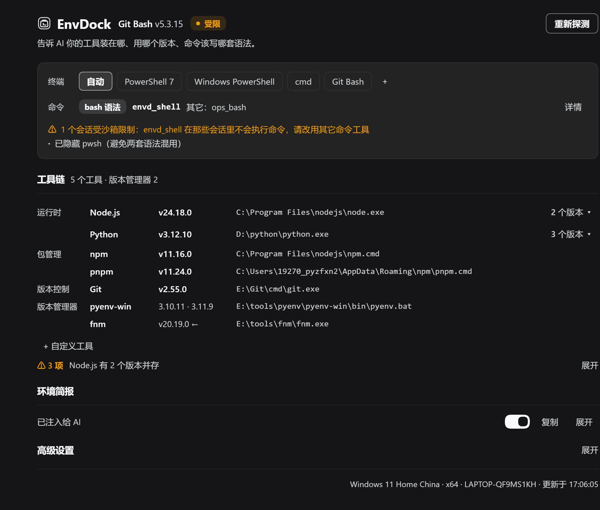
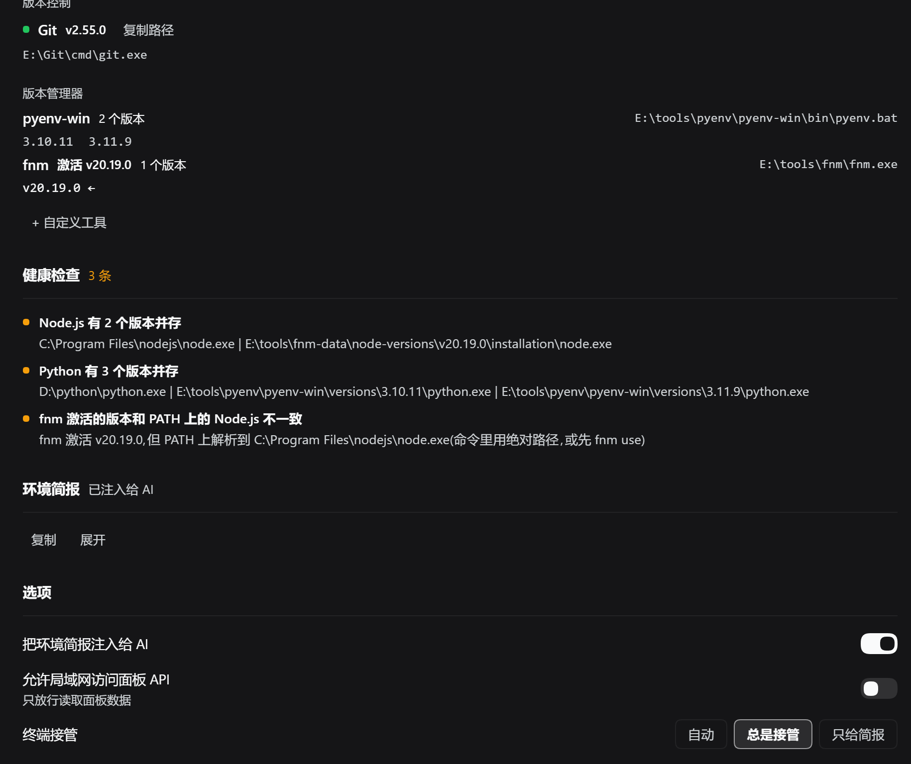

**English** | [中文](README.md)

# EnvDock · Environment Dock

[](https://www.npmjs.com/package/dsh-envdock)
[](LICENSE)


> Tell the agent, before it asks: where Node / Python / Git live on this Windows machine, which version to use, and how commands must be written in this terminal.



> The screenshot shows the **older layout** — the panel is now a one-line header plus a pinned takeover card. Trust the panel you actually open; a new screenshot is pending.

On Windows it is common to have several Node / Python / Git installations side by side, while cmd, PowerShell and Git Bash all disagree on syntax. Without EnvDock the agent has to probe with `where node`, guess paths, write the wrong command and retry. **EnvDock is a DeepSeek Harness (dsh) plugin** that detects your toolchain at startup, injects a ready-made environment brief into the agent's context, and optionally takes over the command tool so the agent always speaks the right shell dialect. No configuration required.

**Who it is for:** people writing code with dsh on Windows; machines with several Node / Python / Git installations; anyone switching between PowerShell, cmd and Git Bash; anyone tired of the agent asking which node you use.

**What it does not do:** it does not install tools, change the system PATH, or decide versions for you — it reports the facts to the agent.

## Why EnvDock

| Without EnvDock | With EnvDock |
|---|---|
| The agent probes with `where` / `Get-Command` every time | Absolute paths and versions are already in context |
| Multiple versions, the agent cannot tell which one you want | Pick a default version in the panel |
| Default shell is PowerShell, the agent writes bash syntax | The brief states the current terminal's syntax rules |
| `nvm use` / `fnm use` disagrees with PATH | A health check points it out |
| Newly installed tools stay invisible until dsh restarts | **Re-scan** re-reads the system PATH |

## Features

- **Toolchain detection** — node, npm, pnpm, yarn, bun, deno, python, pip, uv, git, conda, with **every** candidate path and version.
- **Version managers** — nvm-windows, pyenv-win, conda, fnm, mise are parsed (including the active version where available); Volta and asdf are reported only as present. A manager counts as present only if its command is on PATH or its root really exists.
- **One-click default version** — choose any absolute path in the panel; the agent sees it on the next turn.
- **Environment brief injection** — system, default terminal, absolute tool paths and versions, and syntax notes, written into the run context.
- **Optional shell takeover** — when the default terminal and the host command tool belong to different families, EnvDock registers a stable `envd_shell`, hides the host shells, and switches terminals without an empty tool window. Host command tools are recognised at runtime (`ops_bash`, third-party publication names, …); one that cannot be masked or whose family cannot be recognised gets EnvDock's tool hidden instead (yield), so the session still has exactly one command tool.
- **Health checks** — Store stubs, dead PATH entries, EOL versions, npm/Node mismatch, active version manager vs. PATH drift.
- **The `envd` tool** — `summary` / `resolve` / `check` / `set_default` for the agent.

## Install

**Requirements:** Windows and an installed DeepSeek Harness (dsh). Plugins are installed per profile; the commands below use `web`.

> **The npm build may lag behind** (the published version is 0.1.0). For this round's features (per-session takeover facts, the takeover card, runtime shell discovery), install from a local directory / Git, or wait for 0.3.0 to be published.

### Option 1 — npm (may lag behind)

```powershell
dsh plugin --profile web add dsh-envdock
```

Enable EnvDock in the plugin page if needed, then restart dsh. Replace `web` with `tui`, `headless`, etc. for other profiles.

### Option 2 — Web plugin page (local directory / Git, recommended)

1. Open **Plugins** in the dsh sidebar.
2. Choose install and provide the source:
   - local directory: `link:D:\plugins\envdock` (use your own path)
   - or a Git URL
3. Make sure **EnvDock** is enabled, then restart dsh.

### Option 3 — Command line (local directory, recommended)

```powershell
# Install into the web profile; link: takes the plugin directory
dsh plugin --profile web add link:D:\plugins\envdock

# Restart web
dsh web
```

Enable EnvDock in the plugin page if it was not enabled automatically. Replace `web` with `tui`, `headless`, etc. for other profiles.

> **The panel only exists in the Web UI** (`web` profile): the plugin's `dsh.client.platform` is `web`. `tui` / `headless` can install EnvDock — the brief and the `envd` tool still work — but there is no visual panel to open.

> From source: `git clone https://github.com/tkochj/dsh-envdock.git envdock`, then install it with `link:` as above. Restart dsh after source changes.

### Verify

- EnvDock appears in the sidebar and the panel lists your toolchain.
- A new session contains the `## 本机环境 (EnvDock 实测,优先于猜测)` brief.
- Ask the agent "where is node?" — it answers with an absolute path instead of searching.

## Quick start

1. Open the EnvDock panel from the sidebar.
2. Review the detected toolchain and health checks.
3. Use the pinned **Command tool / takeover** card to switch the terminal and takeover mode; pick default versions under toolchains.
4. Return to the session — the agent already has the updated brief.



> Same caveat: the screenshot is the older layout; health checks and the brief now collapse into one row each.

## Panel guide

The panel is one screen: a one-line header, a pinned **Command tool / takeover** card, toolchains, and a one-line footer; health checks and the brief are collapsed by default.

| Area | Purpose |
|---|---|
| **Header (one line)** | Name, current terminal + version, **one** status badge, issue count (`⚠ N`), and Rescan (re-reads the system PATH and clears the version cache). |
| **Status badge** | Error red "N session(s) with a broken command tool" / warn yellow "N session(s) use the host tool" / ok green "model can see it" / muted grey "not taken over" (also "sandboxed", "provided by another plugin"). Hover for every session plus the common counters. |
| **Command tool / takeover (pinned card)** | Terminal chips; a status line (state word + current command tool name + executor family, marked when it is only the platform default) with takeover-mode chips (auto / always / brief only); sandbox-takeover chips (delegate / refuse) only when a confined session or a confining executor exists. |
| **Per session** | One row each: first 8 characters of the id · outcome (takeover / not taken over / yielded / sandboxed) · tool actually in effect. Broken rows are red with the reason at the end (no tool / host still visible / mask had no effect). First 5 rows by default, then "N more"; anomalous sessions are listed first. |
| **Recognised host command tools** | Chips for host command tools actually seen at runtime (`name · family`); heuristically recognised names carry an "auto-detected" mark; "none detected" otherwise. |
| **Takeover diagnostics (collapsed)** | Collapsed by default, auto-expands on problems (red is reserved for errors). Shows the common counters (including delegate tries / calls / failures / refusals) and the last error with its age; the full field set lives in `/envdock-api` → `syncStats`. |
| **Toolchains** | One row per tool: name, default version, path (**click the path to copy**); multiple versions collapse into an "N versions" chip that reveals candidates and "set as default". Version managers and the custom-tool entry live here too. |
| **Health checks** | Hidden when there is nothing to report; otherwise a one-line count that expands into the list. |
| **Environment brief** | Collapsed into one row: expand / copy. |
| **Footer** | Brief injection, allow-LAN (still clickable when the API answers 403), and copy feedback (`aria-live`). |

The panel polls `/envdock-api` every 15 seconds (only while the page is visible; an unchanged payload does not trigger a re-render). Failures surface as a dismissible error row, copy failures included.

## What the agent sees

A brief like this is injected (content varies per machine):

```text
## 本机环境 (EnvDock 实测,优先于猜测)
- 系统: Windows_NT 10.0.26300 (x64),用户 LAPTOP-XXXX
- 默认终端: Windows PowerShell → C:\Windows\System32\WindowsPowerShell\v1.0\powershell.exe (v5.1.26100)
  · 串联用 `;`,条件串联 `&&`/`||` 只有 PowerShell 7 支持
  · 环境变量 `$env:NAME`,调用外部程序要 `& $exe` 或用完整路径
- 工具(绝对路径,直接用,不必再 where/which):
  · Node.js v24.18.0 → C:\Program Files\nodejs\node.exe [另有 v20.19.0 ...]
  · Python v3.12.10 → D:\python\python.exe [...]
  · Git v2.55.0 → E:\Git\cmd\git.exe
- 版本管理器: pyenv-win(...) [2 个版本], fnm(...) [1 个版本,激活 v20.19.0]
```

The `envd` tool:

| action | Purpose |
|---|---|
| `summary` (default) | Full environment brief |
| `resolve` | Default path, version, all candidates, terminal |
| `check` | Health issue list |
| `set_default` | Switch the default version |

### Shell takeover

- The host command tool is `pwsh` / `bash` etc. When your default terminal is a different family, EnvDock registers a stable `envd_shell` and hides the host shells.
- Same family: EnvDock does nothing and adds no duplicate tool.
- Sandbox is judged **per session**, not by the deployment default: the executor's `sandboxMode` is only the deployment default; the effective policy comes from `sandboxPolicy.resolve({ session })` and has **three states** (confirmed unconfined / confirmed confined / unknown). The legal policy set is a closed one — `read-only` / `workspace-write` / `danger-full-access`; a resolve result of `{}`, an empty mode, or anything outside that set counts as **unknown policy** conservatively and is **never** replaced by the deployment default. `envd_shell` is only registered when **at least one session proves it is unconfined**; a confined session does not disable takeover for other sessions (confined sessions keep the host command tool). An unknown policy is treated conservatively as confined — it is never reported as unconfined. The reverse also holds: if the executor claims it does not confine but the policy service says this session is confined, EnvDock still refuses to spawn or delegate on its own. If **every** session is confined, EnvDock registers no tool at all — each session is "not taken over" and the model simply uses the host tool.
- **Host command tools are recognised at runtime, not from a hard-coded list**: where the host provides `tools.definitions`, EnvDock enumerates them and recognises bash / PowerShell / cmd / WSL by family tokens in the name (`ops_bash`, `tenant_pwsh`, …) and by "description mentions a shell + a command-like parameter (`command` / `cmd` / `script` / `commandline`)". A name containing `cmd` is **not** enough: `run_cmd` (task parameter) or `wc_cmd_palette` (UI palette) are not claimed as host shells. A tool it can name but whose family it cannot recognise is left alone and the session yields — no syntax guessing.
- **A scope-private host shell cannot be masked** — when the host tool is mounted in a scope-private layer (dsh-ops mounts `ops_bash` per session), `restrict` cannot hide it, so EnvDock hides its own `envd_shell` instead. The decision is **per scope**: with the global `pwsh` plus a per-session `ops_bash`, each session only masks the host shells it actually saw; if an unmaskable one is still there, EnvDock yields, so `envd_shell` never coexists with a host tool. Unmaskable names are remembered per scope and retried after about 30 seconds. If both tools ever end up visible (or neither is reachable), the per-session `anomaly` flag surfaces it instead of hiding it behind aggregate numbers.
- **Delegation only supports bash / PowerShell targets**: the wrapper follows the **host executor's** family (`executorFamily`: clues from the `ctx.shell` object/class name first, then the platform default — PowerShell on win32, bash elsewhere), and the command data **never travels on the command line**: a bash target gets the user command as base64 in the `ENVD_CMD` environment variable and runs it via `base64 -d | bash -s`; a PowerShell target uses `-EncodedCommand` (UTF-16LE base64, prefixed with `$ProgressPreference` to suppress 5.1 CLIXML noise). That means the host command line never contains user text, so the PowerShell 5.1 quote-swallowing bug cannot trigger, and an MSYS/Git Bash host cannot rewrite a cmd target's `/d /s /c` into paths. **cmd / WSL / custom-terminal targets are always refused** (the command would silently not run). A cmd executor, an absent executor, a missing session, or a missing/illegal session policy is refused too — never guessed, never replaced by the deployment default.
- **A hidden command tool gives an actionable refusal** (`tools.guard`): a hidden host shell says "EnvDock took over, use `envd_shell`"; conversely, a hidden `envd_shell` in a yield / sandbox session points at the host tool actually visible there (the reason comes from the per-session facts: sandbox-confined, a scope-private host shell, or an unknown policy). The guard judges the replacement by "can it be used right now": through `tools.executable` where the host provides it, otherwise by visibility only; when it cannot tell, it says so or simply lets the call through — it never invents a tool name. It is not a security boundary — under PTC the agent's direct call may be folded into `run_code`, and dsh-ops 0.5.0 may deny/guard first through its own `tools/pre-execute`, so EnvDock's direction-2 message may never appear and `guardDenials` may stay 0. That is normal, not a broken guard.
- **Takeover diagnostics carry the common counters**: the panel shows register tries/registers, disposes, deny applies, ticks, delegate tries/calls/failures/**refusals**, guard refusals, yield ticks, mask releases, the executor family, detection count/duration, whether the guard is registered, whether this tick is steady, and the last error with its age. The full field set (`ownHides`, `hostDenyApplies`, `denyNoops`, `transientMisses`, `steadySinceAt`, `scopeAnomalies`, `runtimeShellTools`, `hasExecutableApi`, …) is in `/envdock-api` → `syncStats`. Delegation counters: entering the delegation path counts as a try; an unsupported target terminal / executor counts as a refusal; only a legal execution result counts as a call.
- If registration fails or the name is taken, EnvDock keeps the host tool instead of leaving you without any command tool.

## Settings and reset

State lives in `~/.dsh/envdock.json` (atomic writes; a corrupt file is backed up as `envdock.json.corrupt` and defaults are restored).

| Option | Default | Meaning |
|---|---|---|
| Inject brief | on | Write the environment brief into the agent context |
| Shell takeover | auto | `auto`: only for different families; `always`; `brief only` |
| Sandbox takeover | delegate | While EnvDock's own tool is still in a confined session's tool table: `delegate` forwards the command through the confining host executor (no sandbox bypass; only **bash / PowerShell targets** are supported, the wrapper follows the executor family and the command travels on a base64 data channel; the terminal choice still applies to that call); cmd / WSL / custom-terminal targets are refused. `refuse` always errors. In steady state a confined session uses the host command tool |
| Allow LAN | off | Once enabled, LAN clients can only **read** panel data. Every write (terminal, default version, custom tool / terminal argv, options) stays local-only; the single exception is a same-origin page turning this switch **off** (turning it on must happen locally, otherwise the terminal argv becomes a LAN-wide command-injection surface) |
| Custom tools | empty | Add tools outside PATH |

```powershell
# Reset everything
Remove-Item ~/.dsh/envdock.json
```

Uninstall from the plugin page, then restart dsh.

## FAQ

**Why does the model see `ops_bash` instead of `envd_shell`?**

The command tool is decided **per session**: in one dsh process, different sessions can hand the model different tools. Seeing `ops_bash` usually means EnvDock **yielded** or **did not take over** in that session — takeover is not broken. Host command tools are recognised at runtime (`ops_bash`, third-party publication names, …); when the family cannot be recognised EnvDock yields instead of guessing syntax. The four outcomes:

| Outcome | When | What the model has | Panel |
|---|---|---|---|
| Takeover | at least one session is unconfined (that is when `envd_shell` gets registered) and this session's host shell was masked successfully | `envd_shell` (default terminal syntax only) | "model can see it" when every session is on takeover; otherwise a per-session summary |
| Not taken over (`host`) | EnvDock does not take over this session: brief only, registration failed / name taken, same family as the host, or **every session is confined (no tool is registered at all)** | the host tool | "N session(s) use the host tool" in mixed setups; when everything is not taken over (or every session is confined) the header shows a single grey badge ("not taken over" / "sandboxed") instead of a yellow warning |
| Yield | the host shell lives in a scope-private layer and `restrict` cannot hide it (dsh-ops mounts `ops_bash` per session), or its family cannot be recognised | that host tool (`ops_bash`) | "N session(s) use the host tool" |
| Sandbox-host | **mixed deployment**: a tool was registered for the unconfined sessions while this session is confined, so `envd_shell` is hidden here | the host's confined command tool | "N session(s) use the host tool" |

Note that `sandbox-host` only exists in a mixed deployment (at least one unconfined session plus this confined one). With a single session, or when **all** sessions are confined, the outcome is `host`: EnvDock does not register `envd_shell` at all.

When yielding, EnvDock hides its own `envd_shell` instead, so the session still has exactly one command tool; the brief says so directly:

```text
· 命令工具: `ops_bash`(宿主自带,用 bash / sh 语法);宿主 shell 在这个会话里挡不掉或无法替代,EnvDock 已让路,直接用这个
```

The plans never hide both tools; if both ever end up visible (or neither is reachable), the per-session `anomaly` flag surfaces it as "N session(s) with an anomalous command tool".

**What do the "N session(s) use the host tool" and "N session(s) with an anomalous command tool" badges mean?**

EnvDock reconciles per session rather than declaring one global takeover state:

- **N session(s) use the host tool** (warn): N counts the sessions that are **not** on direct takeover (not taken over / yield / sandbox-host). The number comes straight from `commandTool.scopes`, not from aggregate counters such as `sandboxHiddenScopes`. Yellow only appears when takeover and non-takeover sessions are mixed; **when no session is taken over the header is a grey "not taken over"** rather than a mixed warning.
- **N session(s) with an anomalous command tool** (error): in that session neither `envd_shell` nor a host command tool is reachable (zero tools), or a takeover leaves the host tool visible (two tools), or a mask did not take effect (`leaked` non-empty). Treat it as a bug signal, not a normal outcome; yielding itself is not an anomaly and no longer gets a ⚠ in the diagnostics row.
- Hovering the badge lists **every** session (takeover included): "first 8 characters of the id · outcome · tool actually in effect", plus mask / confined / policy-unknown / leak annotations and the common counters; the fuller field set is in `/envdock-api`.
- `/envdock-api` exposes the same facts as `commandTool.scopes`: `kind`, `tool`, `hostTool` / `hostTools`, `ownVisible`, `ownNameVisible`, `ownOurs`, `hideOwnPlanned`, `visible`, `hidden`, `leaked`, `hidesOwn`, `confined` (**three states**: true / false / null = unknown policy), `policyKnown`, `mode`, `anomaly`. A new build with no sessions returns `scopes: []` and the panel says "no sessions yet" instead of pretending to be an older build.
- If `/envdock-api` is an older build (no `scopes` field), the title says so ("older build") and only aggregate numbers are shown (`about N sessions`, the old build's `hostOnlyScopes` plus `sandboxHiddenScopes`); restart dsh with the new version to get per-session rows.
- The plain "model can see it" badge appears only when the tool is registered and no session falls back to "not taken over" (with no sessions yet it also shows: the tool is there).

**Why is there no `envd_shell` in a sandbox-confined session?**

Because this session's effective policy is not `danger-full-access` (e.g. `workspace-write`). EnvDock executes through `ctx.subprocess`, which has no `sandboxPolicy` entry — spawning directly would bypass the sandbox. Three cases:

- **All sessions confined**: EnvDock registers no `envd_shell`; every session's `kind` is `host` (not taken over) and the model uses the host's own confined tool. The header shows a single grey badge ("sandboxed" when the executor can confine, otherwise "not taken over") — never "model can see it", and never a yellow mixed warning.
- **Mixed deployment (at least one unconfined session)**: the tool is registered for the others, and the confined session's `kind` is `sandbox-host` — `envd_shell` is hidden there.
- **Unknown policy** (`sandboxPolicy.resolve` throws, no policy service, or a result of `{}` / empty mode / a value outside the closed set): treated conservatively as confined — `envd_shell` hidden, host tool kept; `commandTool.scopes[].confined` is `null` and `policyKnown` is `false`, and the panel marks it "policy unknown". Illegal values never fall back to the deployment default.

Either way the brief talks about the sandbox (the tool name varies per machine):

```text
· 命令工具: `pwsh`(宿主自带,用 PowerShell 语法);本会话被沙箱围栏(workspace-write):EnvDock 不接管(接管会绕过沙箱),以工具表里那个工具为准
```

`sandboxMode` is only the **deployment default**: capability (whether the executor confines at all) / deployment default / this session's effective policy are three separate facts, and the last one is resolved per session via `sandboxPolicy.resolve({ session })` and is **three-state** (confirmed unconfined / confirmed confined / unknown). To use EnvDock's terminal here, switch the session policy to `danger-full-access`; takeover applies on the next reconcile. But if the host shell is scope-private and cannot be masked, the session still yields even without confinement.

"Sandbox takeover → Delegate" is not a switch that keeps EnvDock's terminal in a confined session: delegate forwards the command through the confining host executor (`resolve` + `execute`; the command data travels on the `ENVD_CMD` / `-EncodedCommand` base64 channel, the confinement rides the host process and is inherited), and it only matters during the short window before `envd_shell` is removed from that session's tool table. The wrapper follows the **host executor's** family (`executorFamily`), not the model-facing tool name; and **only bash / PowerShell targets** are supported: a bash target receives the command as base64 in `ENVD_CMD` and runs `base64 -d | bash -s`, a PowerShell target uses `-EncodedCommand` (UTF-16LE base64, `$ProgressPreference` prefix), which sidesteps both "silently does nothing" traps (PowerShell 5.1 swallowing quotes, MSYS rewriting cmd arguments). cmd / WSL / custom-terminal targets are refused outright; a cmd executor, a missing executor, a missing session, or a missing/illegal session policy (empty or out-of-set mode included) is refused instead of falling back to the deployment default.

**No EnvDock in the sidebar?** Check that it is enabled in the plugin page and restart dsh; confirm you installed it into the profile you boot.

**The agent now has only `envd_shell` and fewer capabilities?** The takeover tool is a minimal executor: one foreground command, truncated output, `cwd` / `timeoutMs` — no background jobs, tail files or `sandbox_permissions`. Switch takeover to **brief only** to get the host tool back.

**"This session is sandbox-confined, EnvDock will not take over"?** Because this session's effective policy is not `danger-full-access` (see "Why is there no `envd_shell` in a sandbox-confined session?" above for what happens instead). The executor's `sandboxMode` is only the deployment default — the panel keeps three facts apart: capability, deployment default, and this session's effective policy, and `/envdock-api` lists the per-session policies under `sandbox.scopes`. To use EnvDock's terminal here, switch the session policy to `danger-full-access`; takeover applies on the next reconcile (sooner when the tool table changes).

**Health check says the active version manager differs from PATH?** e.g. fnm is on Node 20 while PATH resolves the system Node 24. Use absolute paths or run `fnm use` first.

**Changed the system PATH but the panel is stale?** Click re-scan; on Windows it re-reads the machine and user registry. On POSIX, or without the host `subprocess` service, restart dsh.

**What can LAN clients do?** Nothing by default. After enabling **Allow LAN** in the panel, LAN clients can only **read** panel data; every write (terminal, default version, custom tool / terminal argv, options) stays local-only. The single exception is a same-origin page turning Allow LAN **off** (turning it on must happen locally) — otherwise a LAN page could rewrite the default terminal argv, which is a command-injection surface. The switch itself stays clickable when the API answers 403.

**What do the red / yellow / grey health tiers mean?** Red = error (Store Python stub, dead default-version path, unusable default terminal, …); yellow = warning (multiple versions side by side, EOL runtime, dead PATH entries, active version manager vs. PATH drift, …); grey = info (e.g. the dsh process PATH is stale).

## Known limits

- Detection covers executables and versions; it does not parse `.nvmrc` / `pyproject.toml` / `package.json` requirements.
- Version detection needs the host `subprocess` service; without it only PATH scanning is done.
- Volta / asdf are presence-only.
- The takeover executor is deliberately minimal.
- A scope-private host command tool cannot be masked; EnvDock yields and that session keeps the host tool (the unmaskable name is retried after about 30 seconds).
- Host command tools are recognised by name / description heuristics: a tool whose family cannot be recognised is neither masked nor taught syntax — EnvDock yields and the model keeps using it as before. A name containing `cmd` alone is not enough: the tool must expose a command-like parameter.
- The refusal guard is an actionable hint, not a security boundary: without `tools.executable` it can only judge by visibility, under PTC a direct call may be folded into `run_code`, and dsh-ops 0.5.0 may deny/guard first through its own `tools/pre-execute`, so EnvDock's direction-2 message may never appear (`guardDenials` may stay 0).
- Delegation only supports **bash / PowerShell targets**: cmd / WSL / custom-terminal targets are refused (the command would silently not run). Confined policies (`read-only` / `workspace-write`) never spawn by themselves — only delegate or refuse. A PowerShell 5.1 host is still safe because commands travel through `-EncodedCommand` / `ENVD_CMD` data channels instead of the command line, but a cmd target simply has no safe delegation path.
- When every session is confined EnvDock registers no `envd_shell` (each session is "not taken over") and the header shows a grey badge, never "model can see it"; `sandbox-host` only appears in a mixed deployment.
- Detection results are cached in memory for 45 seconds; only default-terminal / custom-terminal / default-version / custom-tool changes invalidate them (toggling allow-LAN no longer triggers a full re-scan). Rescan forces a fresh scan and clears the version cache.
- A host command tool only counts while it is **actually visible** (or still inside our mask): once it disappears after having been seen, EnvDock takes over as a fallback instead of assuming "same family as the host" forever. Before the first sighting there is a ~60 second grace window so a late-registering host plugin is not raced.
- Working directory is the current session's, not the dsh process cwd.
- Windows-first; cross-platform details are handled but non-Windows detection is weaker.

Deep implementation notes and design trade-offs: [docs/DESIGN.md](https://github.com/tkochj/dsh-envdock/blob/main/docs/DESIGN.md) (Chinese). What changed in each version: [CHANGELOG.md](https://github.com/tkochj/dsh-envdock/blob/main/CHANGELOG.md).

## Development

```
index.js          Host: detection, envd tool, brief injection, terminal takeover, /envdock-api
client.js         Client: sidebar icon + panel
cordis.patch.yml  bundle patch (insert id: envdock)
locale/           meta.title / meta.description
icon.svg          Plugin icon
CHANGELOG.md      Release notes
test/             parsers, i18n check, host harness, panel render
docs/             Design notes and screenshots
```

```powershell
npm test                    # all four tests in one go (source checkout only)

node test/parsers.mjs
node test/i18n-check.mjs
node test/host-harness.mjs
node test/panel-render.mjs
```

`npm test` only works in a **source checkout**: the npm package does not ship `test/`, so an installed plugin has no tests to run. Issues and pull requests are welcome. Keep the four tests green.

## License

[MIT](LICENSE) © 2026 EnvDock contributors
