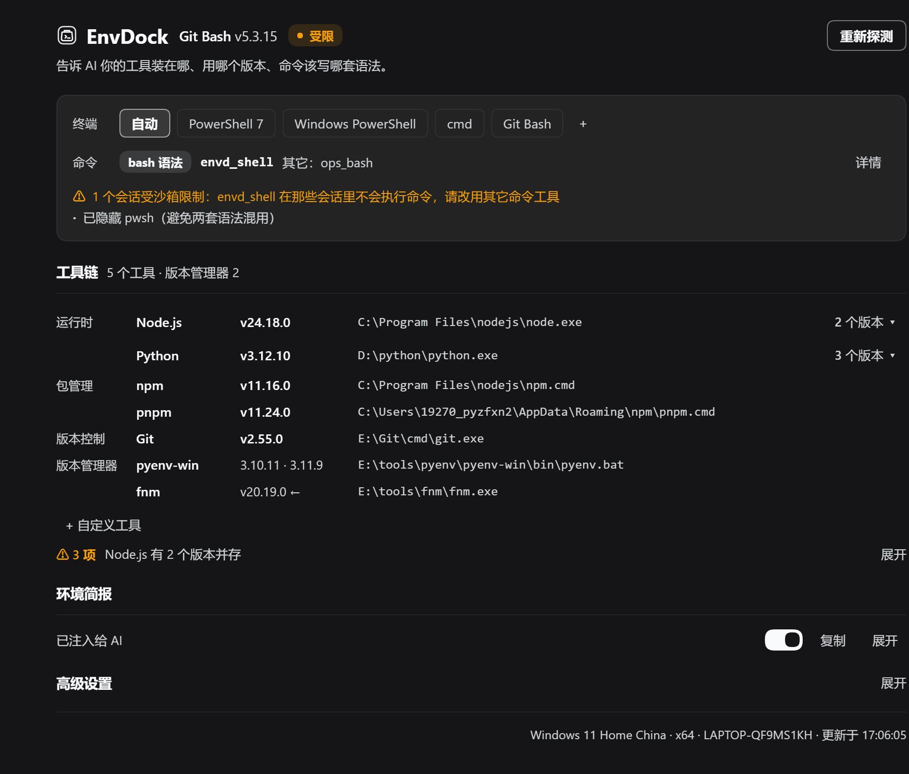

[English](README.en.md) | **中文**

# EnvDock · 环境码头

[](https://www.npmjs.com/package/dsh-envdock)
[](LICENSE)


> 让 AI 开口之前就知道：你的 Windows 上 Node / Python / Git 装在哪、该用哪个版本、这个终端里命令该怎么写。



> 截图是 0.2.0 的首屏（示例里手动选了 Git Bash）：头部一行（图标 · 插件名 · 默认终端与版本 · 一个二态 badge · 重新探测）下面常显一句用途说明；置顶的「终端 / 命令」卡（`命令` 行是「`bash 语法 · 手动` · `envd_shell` · `没有其它命令工具` · 详情」，下面只在需要时出现白话说明，最多两行，例如「另有 N 个会话受沙箱限制：envd_shell 会在沙箱内执行」「已隐藏 pwsh（避免两套语法混用）」）；工具链一行一个工具；环境简报一行（状态 + 行内开关 + 复制 + 展开）；「高级设置」默认收起，里面才是「隐藏另一族命令工具」与「允许局域网访问」两个开关；底部只剩复制反馈与平台 / 更新时间脚注。

Windows 上做开发，机器里常常并排放着好几套 Node / Python / Git，cmd、PowerShell、Git Bash 又各有各的语法。没有 EnvDock 时，AI 要先 `where node` 试探、猜路径、写错命令再重试——慢，而且容易在版本和语法上踩坑。

**EnvDock 是 DeepSeek Harness（dsh）的插件**：启动时把本机工具链探测清楚，把一份「环境简报」直接写进 AI 的上下文，并按**会话**只放行一个语法族（bash 族或 PowerShell 族）；需要时再增补一个用你终端的命令工具（`envd_shell`），让 AI 用正确的方式干活。你不用填任何配置。

**适合谁**：在 Windows 上用 dsh 写代码的人；机器上装了多套 Node / Python / Git 的人；经常在 PowerShell、cmd、Git Bash 之间切换的人；希望 AI 少问「你用的哪个 node」的人。

**它不做什么**：不安装工具、不改系统 PATH、不替你决定版本。默认**只增补、不遮挡**；0.6 的唯一例外是 bash 族会话里遮挡另一族的**内置** PowerShell 命令工具（`pwsh` / `powershell`），可用「隐藏另一族命令工具」开关关掉。

## 为什么需要它

| 没有 EnvDock | 有 EnvDock |
|---|---|
| AI 每次都要 `where` / `Get-Command` 试探 | 简报里直接给绝对路径与版本 |
| 多版本并存，AI 猜不到你想用哪个 | 面板点一下设定默认版本 |
| 默认是 PowerShell，AI 却写 bash 语法 | 简报按会话只给一个族的语法要点 |
| `nvm use` / `fnm use` 与 PATH 不一致，问题难查 | 健康检查直接点出来 |
| 装了新工具要重启 dsh 才「看得见」 | 「重新探测」按系统当前 PATH 重扫 |

## 功能一览

- **工具链探测**：node、npm、pnpm、yarn、bun、deno、python、pip、uv、git、conda，列出**全部**候选路径与版本。
- **版本管理器探测**：nvm-windows、pyenv-win、conda、fnm、mise 会解析已装版本（前四还解析当前激活项）；Volta、asdf 只报「在场」，不猜输出格式。只有命令在 PATH 上或根目录真实存在才算在场。
- **默认版本一键切换**：多版本并存时，在面板里把某个绝对路径设为默认，AI 下一轮就按它来。
- **环境简报注入**：系统、默认终端、各工具绝对路径与版本、**本会话的语法族**，一次写进运行上下文。
- **按会话只暴露一个语法族（0.6）**：bash 族（`ops_bash` / `bash` …）与 PowerShell 族（`pwsh` / `powershell`）分开；bash 族会话里宿主的内置 `pwsh` / `powershell` 会被遮挡（可直接隐藏的用 `tools.restrict`，挡不掉的调用前拒绝）。开关「隐藏另一族命令工具」可关掉遮挡，回到两族同时可见。
- **命令工具增补（可选）**：主族终端可用时额外注册一个固定名字的 `envd_shell`（用你的终端与 PATH），并按**调用会话的族**取终端。围栏（受限）会话里命令会**委托给宿主的沙箱执行器在沙箱内执行**（写文件仍受沙箱策略限制）；只有这个部署没法安全委托时才拒绝，并指路宿主工具。
- **健康检查**：应用商店占位符、失效的 PATH 目录、旧版本、npm/Node 不配套、版本管理器激活版本与 PATH 不一致等。
- **`envd` 工具**：让 AI 随时按名字解析工具（`resolve`）、取简报（`summary`）、查健康（`check`）、切换默认版本（`set_default`）。

## 安装

**前置条件**：Windows + 已安装 DeepSeek Harness（dsh）。插件以当前 profile 为单位安装，下面以 `web` 为例。

> **npm 上的 `dsh-envdock@latest` 就是本仓库的发布版本（以 npm 的 `latest` 标签为准），直接装即可。** 仓库 `main` 可能领先于最近一次发布（开发中的改动），想用那一版再用下面的本地目录 / Git 方式安装。
>
> **版本对应关系**：对外发布从 **0.2.0** 开始（npm 0.1.0 → 0.2.0，后续 0.2.x 为发布版本）；仓库开发期的 0.5 / 0.6 编号只作内部迭代记录，从未发布，对应关系见 CHANGELOG。

### 方式一：从 npm 安装（推荐）

```powershell
dsh plugin --profile web add dsh-envdock
```

安装后在插件页确认 EnvDock 已启用，然后重启 dsh。其他 profile 把 `web` 换成对应名字。

### 方式二：在 dsh 插件页安装（本地目录 / Git）

1. 打开 dsh 侧边栏的 **插件** 页。
2. 选择「安装」，填入插件来源，二选一：
   - 本地目录：`link:D:\plugins\envdock`（换成你的实际路径）
   - Git 地址：本仓库的 git URL
3. 确认 **EnvDock** 处于开启状态，然后重启 dsh。

### 方式三：命令行（本地目录）

```powershell
# 把插件装进 web profile；link: 后面是插件目录的绝对路径
dsh plugin --profile web add link:D:\plugins\envdock

# 重启 web
dsh web
```

安装后如果插件页里 EnvDock 没有自动启用，手动打开开关再重启。其他 profile（`tui`、`headless` 等）把 `web` 换成对应名字即可。

> **面板只在 Web（`web` profile）里有**：插件的 `dsh.client.platform` 只有 `web`。`tui` / `headless` 可以安装，环境简报与 `envd` 工具照常生效，但没有可视化面板可点。

> 从源码使用：`git clone https://github.com/tkochj/dsh-envdock.git envdock`，再用上面的 `link:` 方式安装。源码改动需要重启 dsh 生效。

### 验证安装

- 侧边栏出现 **EnvDock** 入口，点开能看到默认终端与工具链。
- 新开会话时，AI 的上下文里会出现「本机环境 (EnvDock 实测,优先于猜测)」简报。
- 在对话里问 AI「我的 node 在哪」，它应该直接给出绝对路径，而不是现搜。

## 快速上手

1. **打开面板**：侧边栏 → EnvDock。
2. **看一眼探测结果**：工具链、版本管理器、健康检查。
3. **按需调整**：在置顶的「命令工具」卡里切默认终端；在工具链里点路径复制、点「N 个版本」选默认版本。
4. **回到会话**：AI 已经拿到新的环境简报，直接干活。

## 面板导览

面板按「首屏说四件事」组织：**这台机器默认用哪个终端**、**这一轮该写哪套语法**、**装了哪些工具**、**有没有问题**。首屏默认不出现「族 / 宿主 / 围栏 / 增补」这类内部说法——族在面板里叫「`bash 语法` / `PowerShell 语法`」，宿主命令工具叫「其它命令工具」，围栏叫「受沙箱限制」；技术细节收在「详情」与「高级设置」里。720px 高的窗口（可用约 600px）里，常显内容基本不需要滚动。

| 区域 | 常显内容 |
|---|---|
| **头部（一行 + 一句用途）** | 图标 · 插件名 · 默认终端与版本（如 `Git Bash v5.3.15`）· **恰好一个二态**状态 badge · 右侧「重新探测」（按系统**当前** PATH 重扫，Windows 会重读注册表并清空版本缓存；同时重新判定语法选择：清掉此前的会话判定与隐藏记忆）。下面常显一句用途：「告诉 AI 你的工具装在哪、用哪个版本、命令该写哪套语法。」 |
| **状态 badge** | 整个面板唯一的状态结论，白话二态：绿「就绪」（命令工具可用）、灰「只展示」（没提供命令工具，面板只列其它命令工具）。「有会话受沙箱限制」不上面板级 badge（面板是全局的，没主语的「受限」容易被当成插件坏了），只写进备注；不带族后缀，悬停显示最多两条说明。 |
| **命令卡 · 终端** | `终端` chips：`自动` + 探测到的各终端 + `+`（自定义终端：路径 / 名称 / 参数模板）。chips 只显示终端名，没有族小标；`自动` 的悬停是「按会话自动选语法族（推荐）」。切终端立即生效。 |
| **命令卡 · 命令** | `命令` 行：语法标签（`bash 语法` / `PowerShell 语法`，**手动选择才有「· 手动」**）· `envd_shell`（**没提供时显示 `—`**）· `其它：ops_bash · pwsh`（一个都没有就写「没有其它命令工具」）· 右侧「详情」。悬停分别解释两者的环境 / PATH 来自哪里。 |
| **备注（最多两行，全白话）** | 只在需要时出现：没提供命令工具的原因（`没找到可用的终端（bash 语法需要 Git Bash，PowerShell 语法需要 pwsh）` / `没有不受沙箱限制的会话，暂时不会提供 envd_shell` / `和别的插件重名了，暂时不提供 envd_shell` / `没能提供命令工具（注册失败）`）、受沙箱限制（能委托：`另有 N 个会话受沙箱限制：envd_shell 会在沙箱内执行（文件写入可能被拒绝）`；不能委托：`另有 N 个会话受沙箱限制：envd_shell 在那些会话里不会执行命令，请改用其它命令工具`）、`手动选的语法不可用（没有对应终端，也没有对应命令工具），已自动改回按会话选择`、`手动选了 PowerShell 语法：PowerShell 与 bash 工具都在，各按自己的语法写，别混用`、`已隐藏 pwsh（避免两套语法混用）`、`这个会话没有可用的 bash 命令工具，未隐藏 PowerShell 工具`（只在确实没有任何 bash 入口、且 `hidden` / `refuseOnly` 都为空时出现）。普通状态下不显示备注；「其它命令工具的环境可能和你的终端不一样」这类解释放在 `其它：…` 的悬停里。 |
| **详情（默认收起）** | `扫描 N 次 · 最近 Nms · 注册尝试 N` + 命令工具 chips（`名字 · 语法`，靠名字 / 描述启发式认出来的带 ✦「自动识别」；被隐藏、只能拒绝、只展示各带标签）+ 最近错误。 |
| **工具链** | 每个工具**一行**：分组名（只在该组第一行出现）· 名称 · 版本 · 路径（**点路径即复制**）· 行尾「N 个版本 ▾」（点开才列候选与「设为默认」）。版本管理器也一行一个（激活版本带 ←），末尾是「+ 自定义工具」入口。 |
| **环境检查（工具链末尾一行）** | 健康时 `✓ 通过`；有问题时 `⚠ N 项` + 第一条标题，点开展开完整列表（红 / 黄 / 灰分档）。 |
| **环境简报（一行）** | 「已注入给 AI / 未注入」+ **行内注入开关** +「复制」+「展开」；展开才显示简报正文。 |
| **高级设置（默认收起）** | 展开后是两个不常动的开关：「隐藏另一族命令工具」（默认开；可见说明一行「bash 会话里隐藏 PowerShell 的 pwsh / powershell」，关掉的后果在悬停里）与「允许局域网访问面板 API」。 |
| **底部（一行）** | 有数据时**没有开关**：复制反馈（`aria-live`）+ 右侧平台 / 更新时间脚注；拿不到数据（403 / 接口没响应）时，「允许局域网访问」开关会留在这里作为唯一入口。 |

面板没有「接管模式 / 沙箱下接管」设置 chips，也没有逐会话表与状态胶囊。0.6.1 又把技术味最重的装饰收掉：终端 chip 的族小标、badge 的族后缀、底部与简报区重复的开关都删了，首屏每句话都能直接回答「我该写哪套语法」「这个工具是什么」。面板每 15 秒静默拉一次 `/envdock-api`（只在页面可见时拉；payload 没变就不重渲染，所以计数变化本身不一定刷新界面）。任何操作失败都会出现可关闭的错误条，复制失败也会明确提示，不再静默吞掉。

## AI 看到什么

### 环境简报

插件会把类似下面的一段文字写进运行上下文（具体内容随机器变化）：

```text
## 本机环境 (EnvDock 实测,优先于猜测)
- 系统: Windows_NT 10.0.26300 (x64),用户 LAPTOP-XXXX
- 默认终端: Git Bash → E:\Git\bin\bash.exe (v5.3.15)
  · 命令工具(bash 族): 宿主 `ops_bash` + `envd_shell`(EnvDock 增补,Git Bash,同语法);PowerShell 族宿主工具已隐藏(`pwsh`),不要调用 pwsh;使用分工:需要你机器上的版本(node/pnpm/python/git)时用 envd_shell,需要后台作业或沙箱提权参数时用 ops_bash
- 工具(绝对路径,直接用,不必再 where/which):
  · Node.js v24.18.0 → C:\Program Files\nodejs\node.exe [另有 v20.19.0 ...]
  · Python v3.12.10 → D:\python\python.exe [...]
  · Git v2.55.0 → E:\Git\cmd\git.exe
- 版本管理器: pyenv-win(...) [2 个版本], fnm(...) [1 个版本,激活 v20.19.0]
- `envd` 工具只能解析上面已探测到的工具;没列出的不在探测范围内(需要时用 `command -v` / `Get-Command` 自行确认,别用 `envd` 试探)。
```

### `envd` 工具

| action | 作用 | 何时用 |
|---|---|---|
| `summary`（默认） | 完整环境简报 | 想看 AI 拿到的原文 |
| `resolve` | 按名字返回默认路径、版本、全部候选、终端 | 需要精确路径或确认版本 |
| `check` | 返回健康问题清单 | 排查环境问题 |
| `set_default` | 把某个候选路径设为默认 | 切换版本 |

`resolve` 支持别名：`python` / `python3` / `py` 会命中同一条 Python 记录；`py.exe` 是启动器，结果里会单独说明 `py -3.10` 这类用法。

### 命令工具：按会话只暴露一个语法族

0.6 的核心变化。EnvDock 把命令工具分成两族：

- **bash 族**：宿主 `bash` / `sh` / `zsh` / `fish` / `ops_bash`，以及按名字 / 描述启发式认出的第三方 bash 工具。
- **PowerShell 族**：宿主 `pwsh` / `powershell`。
- `cmd` 与自定义终端**不参与自动选族**，也不会被遮挡；手动把默认终端选成 WSL 时按 bash 语法算。

**怎么选族**：自动模式下**按会话**判定——会话第一次出现时，能看到 bash 族宿主工具就是 bash 族，否则 PowerShell 族；判完就锁定。只有一个兜底：首次判成 PowerShell 族后的 10 秒内，如果 `ops_bash` 这类 bash 族工具才挂上来（dsh-ops 启动有先后），允许升级到 bash 族一次。手动把默认终端设成 `pwsh` / `powershell` 或 `bash` / `wsl` 时，所有会话按手动族。手动选的族**既没有可用终端、也没有按该族发布的宿主工具**时会回退自动选族（`familyFallback=true`，简报与面板都会说明原因），该族恢复可用后自动回到手动族；探测还没就绪时不会误判。

**遮挡（默认开）**：bash 族会话里，只要本会话**有 bash 入口**，宿主的内置 `pwsh` / `powershell` 就会被遮挡——能直接隐藏的用 `tools.restrict` 从工具表里去掉；发布在 agent 自有层、`restrict` 挡不掉的，调用时直接拒绝（不 spawn）。「有 bash 入口」有三种：看得见 bash 族宿主工具（如 `ops_bash`）、上次已经遮过（粘性）、或**手动选了 bash 且 `envd_shell` 在本会话能跑**（bash 终端可用，且本会话不受限或受限但能委托宿主沙箱执行）——所以手动选 bash 时以你的选择为准，即使宿主只有 `pwsh`（例如 dsh-ops 关闭时）也会隐藏它，模型改用 `envd_shell`（bash）。只有**确实没有任何可用的 bash 命令工具**时才不遮挡，并在简报 / 面板写明「未遮挡」。bash 族名字永不被遮挡；启发式认出的 PowerShell 族名字只展示。关掉面板里的「隐藏另一族命令工具」开关、切换会话族、agent 结束或插件卸载都会撤销遮挡。手动选 PowerShell 族、而会话里又有 `ops_bash` 时不遮挡，简报告诉模型「两族同时可见，各按自己的语法写命令，不要混写」。

**`envd_shell` 什么时候注册**（三条同时满足）：① 主族终端可用（主族 = 全局默认族：手动选族就是手动族，否则按本机宿主工具判定；没有终端时 `skipReason='no-family-terminal'`）；② 沙箱允许——没有沙箱执行器（或执行器不围栏）就直接注册；有执行器时，只有「没有任何会话是 `danger-full-access`」**且**「这个部署不能把命令委托给宿主沙箱执行器」才不注册；**能委托时即使全部会话受限也照常注册**，受限会话里命令在沙箱内执行；③ 名字 `envd_shell` 没被别的插件占用、注册不报错（失败按 30 秒退避重试，`tools/change` 时立即重试）。0.5 的「与宿主同族不重复提供」已删除——bash 族会话里 `envd_shell`（Git Bash）与宿主 `ops_bash` 并存是**预期状态**，分工写在简报里。

- **执行时按调用会话的族取终端**：bash 族会话用 bash 族终端（本机是 Git Bash），PowerShell 族会话用 PowerShell；同一台机器上不同会话可以用不同终端。该族没有可用终端时直接说明，不会静默换成另一族的 shell。
- **围栏（受限）会话里走宿主沙箱执行器**：`envd_shell` 自己不 spawn 一条没有 `sandboxPolicy` 的命令；受限会话里它把命令**委托**给宿主的 `ctx.shell`（`resolve` → `execute` → `result`），围栏挂在宿主进程上、目标终端作为子进程继承它。命令文本按 base64 经环境变量 `ENVD_CMD` 传入（不拼字符串、不经 shell 引号），request 带本会话的 `sandboxPolicy`、工作目录、`timeoutMs` 与取消信号。输出以 `[sandbox] 委托宿主执行器执行(<mode>)` 开头，文件写入被策略拒绝时会明确标注。
- **只有这个部署没法安全委托时才拒绝**：宿主没有 `shell.resolve/execute`、宿主执行器语法族不是 bash / PowerShell（cmd / 认不出）、目标终端是 cmd / WSL / 自定义终端、拿不到合法 `sandboxPolicy`（绝不拿部署默认档冒充）、命令太长（base64 > 30000）。此时返回 `[sandbox] 本会话受宿主沙箱限制(<mode>),EnvDock 无法在沙箱内执行这条命令: <原因>。请改用宿主命令工具(…)`，并指路宿主工具；**不会退回无围栏 spawn**。
- **沙箱按会话判，不按部署默认档判**：执行器公布的 `sandboxMode` 只是**部署默认档**，真实策略逐会话 `sandboxPolicy.resolve({ session })`；合法策略是闭集 `read-only` / `workspace-write` / `danger-full-access`，返回 `{}`、空 mode 或闭集外的值一律按「策略不可知」处理（委托路径此时直接拒绝，绝不回落到部署默认档）。`/envdock-api` 的 `sandbox` 只给聚合值（`sessionCount` / `confinedCount` / `anyUnconfined` / `delegatable`），不含逐会话明细。
- **简报按会话写**：开头标出族，列出本会话真正看得到的命令工具；被隐藏 / 只拒绝 / 只展示分别说明；两族同时可见时警告不要混写。受限会话分两句：能委托时写「本会话受沙箱限制:envd_shell 会通过宿主执行器在沙箱内执行(文件写入可能被拒绝)」；不能委托时写「…且无法在沙箱内执行:改用宿主工具」。执行分工保留：需要你机器上的版本（node / pnpm / python / git）用 `envd_shell`，需要后台作业或沙箱提权参数用宿主工具。
- **宿主命令工具的识别**：从 `tools.definitions`（逐 agent 一次）按内置家族表与「描述提到 bash / PowerShell / cmd / WSL 且参数里有 command 类字段」认出来。`ops_bash` 属于内置 bash 家族，命中内置表就不再要求 command 参数；`run_cmd`（task 参数）、`ops_read_files` 这类不会被误认。这个名单决定**选族与遮挡目标**，但遮挡名单只含内置 `pwsh` / `powershell`。
- **不遮挡 bash 族，也不挡第三方名**：这是 0.6 的硬边界（测试断言 `restrict` 的 `deny` 集合只可能是 `{ pwsh, powershell }` 的子集）。需要挡的是「另一族的内置命令工具」，不是「别人的工具」。
- **和 dsh-ops 共存不需要任何设置**：`ops_bash` 按 bash 族认领（它发布在 agent 自有层，`restrict` 永远挡不掉它）；dsh-ops 的 `deny-host-shell` 是 guard、EnvDock 是 restrict + guard，两层单调叠加、不冲突。同时开启时同一批内置 PowerShell 名会被两边各挡一次——**重复但无害**，不需要在本插件或 dsh-ops 里改任何开关。
- **不注册也不会让模型没工具用**：宿主工具一直原样在，EnvDock 只是少一个增补入口。

## 设置与状态

配置保存在 `~/.dsh/envdock.json`（原子写入；损坏时自动备份为 `envdock.json.corrupt` 并回落到默认值）。

| 选项 | 默认 | 说明 |
|---|---|---|
| 简报注入 | 开 | 是否把环境简报写进 AI 上下文 |
| 隐藏另一族命令工具 | 开 | bash 族会话里遮挡宿主的内置 `pwsh` / `powershell`；关掉则两族同时可见（简报与面板只警告，不遮挡）。面板里收在默认收起的「高级设置」中 |
| 允许局域网访问 | 关 | 打开后局域网只能**读**面板数据。所有写操作（切终端、改默认版本、加自定义工具 / 终端 argv、改选项）都只允许在本机发起；唯一例外是同源页面把本开关**关掉**（打开必须在本机，否则等于把命令注入面开到局域网） |
| 自定义工具 | 空 | 补充 PATH 之外的工具 |

> **0.5 起没有「接管」选项，0.6 起有「隐藏另一族」**：旧版本里的 `shellTakeover`（终端接管：自动 / 总是接管 / 只给简报）与 `sandboxTakeover`（沙箱下接管：委托执行 / 直接拒绝）已删除，旧状态文件里出现这两个字段会被**忽略**（不报错、不迁移）。0.6 新增 `blockOtherFamily`（对应面板上的「隐藏另一族命令工具」），默认开；它是唯一能让 EnvDock 去动别人工具表的开关，而且只影响宿主的**内置** `pwsh` / `powershell`。

### 重置 / 卸载

```powershell
# 重置所有设置（默认终端、默认版本、选项）
Remove-Item ~/.dsh/envdock.json

# 卸载：在插件页移除 EnvDock，然后重启 dsh
```

删掉状态文件即回到全自动，不会影响其他插件。

## 常见问题

**为什么我的 `pwsh`（或 `powershell`）工具不见了？**

因为本会话被判定为 **bash 族**，而「隐藏另一族命令工具」开关是开的（默认）。0.6 的规则是：bash 族会话里，只要本会话**有 bash 入口**——看得到 bash 族宿主工具（比如 dsh-ops 的 `ops_bash`）、之前已经遮过，或你手动选了 bash 且 `envd_shell` 在本会话能跑——宿主的内置 `pwsh` / `powershell` 就会被遮挡：能直接隐藏的从工具表里去掉，挡不掉的调用时拒绝。目的是让模型只拿到一个语法族的命令工具，不再混着写两种语法。`cmd` 与自定义终端不受影响；bash 族名字和第三方工具永远不会被挡。

**想把 `pwsh` 要回来怎么办？**

两种办法，都不用重启 dsh：① 在面板里把默认终端切到 **PowerShell 7 / Windows PowerShell**——手动选族，所有会话按 PowerShell 族，不再遮挡；② 在面板「高级设置」里把「隐藏另一族命令工具」开关关掉，回到 0.5 的两族同时可见（简报只提醒「各按自己的语法写命令，不要混写」）。注意自动选族是**判定即锁定**的：不会因为你切一下终端就来回改，手动选择才覆盖它。

**为什么模型手里有两个命令工具？**

分两种情况：① **同族两个**——bash 族会话里 `envd_shell`（Git Bash）和宿主 `ops_bash` 都是 bash 语法，这是**预期状态**，简报写分工：需要你机器上的版本（node / pnpm / python / git）用 `envd_shell`，需要后台作业或沙箱提权参数用 `ops_bash`；② **跨族两个**——手动选 PowerShell 族但会话里有 `ops_bash`（或关掉了遮挡开关），此时简报与面板会警告「两族同时可见，各按自己的语法写命令，不要混写」。

**我手动选了 bash，为什么以前不隐藏 `pwsh`？**

0.6.3 起会隐藏了。以前只有「本会话能看到 bash 族宿主工具」才遮挡，所以 dsh-ops 关闭、宿主只有 `pwsh` 的机器上，手动选 bash 也不会隐藏 PowerShell——面板还会说「没有 bash 命令工具，未隐藏」，和你自己的选择打架。现在手动选 bash 时以你的选择为准：只要 `envd_shell` 在本会话能跑（bash 终端可用，且本会话不受限或受限但能委托宿主沙箱执行），即使没有任何 bash 宿主工具也会隐藏 `pwsh` / `powershell`，模型改用 `envd_shell`（bash）。

什么时候仍然不隐藏：手动 bash 但**没有任何可用的 bash 命令工具**——没有 bash 终端、或本会话受限且这个部署不能委托、或 `envd_shell` 注册失败（重名 / 报错）；这时保留 PowerShell 工具，并在简报与面板写明「没有可用的 bash 命令工具，未遮挡」。机器上本来就没有内置 `pwsh` / `powershell` 时也看不出效果；关掉「隐藏另一族命令工具」开关当然也不隐藏。

**受限（围栏）会话里 `envd_shell` 还能用吗？**

能。受限会话里 `envd_shell` 不再自己 spawn，而是把命令**委托给宿主的沙箱执行器**（`ctx.shell`）在沙箱内执行：围栏挂在宿主进程上，目标终端作为子进程继承它，所以命令仍然受本会话策略限制（`read-only` / `workspace-write` 下写文件可能被拒绝，输出里会明确标注）。命令按 base64 经环境变量 `ENVD_CMD` 传给执行器，不拼字符串、不经 shell 引号。执行时仍按**调用会话的族**取终端（bash 族 → Git Bash），所以同一台机器上不同会话可能跑在不同终端里。

什么时候还是不行：宿主没有提供沙箱执行器（没有 `resolve` / `execute`）、宿主执行器语法族不是 bash / PowerShell（cmd 或认不出）、目标终端是 cmd / WSL / 自定义终端、拿不到本会话的合法 `sandboxPolicy`、或命令太长（base64 超过 30000）。这时返回 `[sandbox] 本会话受宿主沙箱限制(<mode>),EnvDock 无法在沙箱内执行这条命令: <原因>` 并提示改用其它命令工具——它们自带沙箱执行。想让这个会话完全不受限（写文件也随便），把会话权限切到 `danger-full-access`（下一次检查生效）；如果**全部**会话都受限、而这个部署又不能委托，EnvDock 干脆不注册（面板备注「没有不受沙箱限制的会话，暂时不会提供 envd_shell」）。

**装了但侧边栏没有 EnvDock？**
去插件页确认 EnvDock 已启用，并重启 dsh。用命令行安装时，确认 `add` 的是正确的 profile。

**健康检查说「版本管理器激活的版本和 PATH 不一致」？**
典型场景：`fnm` 激活了 v20，但 PATH 上的 `node` 仍解析到系统安装的 v24。按提示在命令里用绝对路径，或先 `fnm use` / `pyenv shell` 让 PATH 跟上。

**改了系统 PATH，面板还是旧的？**
点「重新探测」。Windows 上会重读机器级 + 用户级注册表；POSIX 或宿主没有 `subprocess` 服务时只能读 dsh 启动时的进程 PATH，需要重启 dsh。

**局域网能做什么、不能做什么？**
局域网默认什么都读不到。在面板打开「允许局域网访问」后，局域网只能**读**面板数据；写操作（切终端、改默认版本、加自定义工具 / 终端 argv、改选项）一律只允许在本机发起。唯一允许的局域网写是**同源页面把「允许局域网访问」关掉**（打开必须在本机）——否则局域网里就能改默认终端的 argv，等于把命令注入面开到整个局域网。被 403 挡在门外时，面板底部仍会保留这个开关本身，可以直接点。

**红黄灰三档健康检查各代表什么？**
红 = 错误（应用商店 Python 占位符、默认版本路径失效、默认终端不可用等）；黄 = 警告（多版本并存、版本过旧、PATH 有失效目录、版本管理器激活版本不一致等）；灰 = 提示（如 dsh 进程里的 PATH 是旧的）。

## 已知边界

- 探测的是**可执行文件与版本**，不解析 `.nvmrc` / `pyproject.toml` / `package.json` 里的版本要求。
- 版本探测依赖宿主的 `subprocess` 服务；没有它时只做 PATH 扫描，版本列显示「版本未知」。
- Volta / asdf 只报「在场」，不解析版本列表（输出格式随平台变，宁可不猜）。
- **遮挡是唯一例外，而且有代价**：bash 族会话看不到宿主的 Windows 原生能力——注册表、COM、`Get-*` 命令都只有 PowerShell 才有。需要它们时把默认终端切到 PowerShell 族，或关掉「隐藏另一族命令工具」开关。`cmd`、自定义终端、bash 族名字与启发式认出的第三方名字都不受影响。
- **手动 bash 时优先按你的选择遮挡**：只要 `envd_shell` 在本会话能跑，即使宿主没有 bash 族命令工具也会隐藏 PowerShell 内置名；只有「没有任何可用的 bash 命令工具」（没 bash 终端 / 受限且不能委托 / 注册失败）时才不遮挡，并在简报与面板写明未遮挡。
- **选族是单向锁定的**：会话首次判定后不再来回切；只有「首次判成 PowerShell 族」的 10 秒内允许升级到 bash 族一次（兜 dsh-ops 晚挂载 `ops_bash`）。要改就手动选族。
- **非 Windows 没有测试覆盖**：两族判定按 Windows 上常见的宿主命令工具名（`pwsh` / `powershell` / `ops_bash` …）工作，POSIX 上逻辑同构但没跑过。
- 增补出来的 `envd_shell` 是**精简执行器**：单次前台、输出截断、支持 `cwd` / `timeoutMs`，没有后台作业 / tail 落盘 / `sandbox_permissions` 升级。要这些能力就用宿主自带的命令工具（它一直在）。
- **受限会话的委托依赖宿主执行器**：宿主没有 `ctx.shell`（`resolve` / `execute` / `result`）或 `sandboxPolicy` 服务、或执行器语法族不是 bash / PowerShell 时，只能拒绝并指路；EnvDock 绝不自己 spawn 一条没有围栏的命令。
- **仍然不能委托的边界**：目标终端是 cmd / WSL / 自定义终端（只支持 bash / PowerShell 目标）；命令太长（base64 载荷 > 30000）。
- **沙箱内写文件可能被策略拒绝**（`read-only` / `workspace-write`）：输出里会标注 `[sandbox: 文件操作被沙箱拒绝 …]`，这是策略本身，不是工具坏了，也不要换旁路重试。
- 注册的三条条件（主族终端可用 / 沙箱允许 / 名字没被占）任一不满足就不注册，面板只展示其它命令工具；原因在备注与 `commandTool.skipReason` 里。全部会话受限时**只有这个部署不能委托**才属「沙箱不允许」，能委托时照常注册。
- 宿主命令工具靠名字 token / 描述启发式识别：认不出来会影响选族依据与详情里的 chips，但**不影响模型怎么调那个工具**；遮挡名单只认内置 `pwsh` / `powershell`。
- 探测结果在内存里缓存 45 秒：只有改默认终端 / 自定义终端 / 默认版本 / 自定义工具会让它立即失效，改「允许局域网访问」这类选项不再触发全量重扫；「重新探测」会强制重扫并清空版本号缓存（版本号本身缓存 10 分钟，key 含 mtime+size）。
- 工作目录取**当前会话的工作目录**，不是 dsh 进程的 cwd。
- 定位以 Windows 为主；PATH 分隔符、`PATHEXT`、`.cmd/.bat` 垫片、POSIX 终端目录等跨平台细节已处理，但 Windows 之外的探测能力弱于 Windows。

更深的实现细节、设计取舍与自测说明见 [docs/DESIGN.md](https://github.com/tkochj/dsh-envdock/blob/main/docs/DESIGN.md)；各版本改了什么见 [CHANGELOG.md](https://github.com/tkochj/dsh-envdock/blob/main/CHANGELOG.md)。

## 开发

```
index.js          Host：探测、envd 工具、简报注入、命令工具增补、/envdock-api
client.js         Client：侧边栏图标 + 中央面板
cordis.patch.yml  bundle patch（insert id: envdock）
locale/           meta.title / meta.description（中英）
icon.svg          插件图标
CHANGELOG.md      版本变更记录
test/parsers.mjs        版本管理器输出解析自测
test/i18n-check.mjs     client.js 静态自检（词条/占位符/slot）
test/fixture/host.mjs   共享宿主夹具（假 Cordis 服务 + 真实 index.js，下面两个测试共用）
test/host-harness.mjs   Host 运行时夹具（替身服务，全链路）
test/simulate.mjs       用共享夹具跑真实 index.js，打印 /envdock-api 快照（人工排查 / 管道）
test/panel-render.mjs   面板渲染回归（极简 React 替身，零依赖）
test/family.mjs         两族纯逻辑回归（选族 / 锁定 / 遮挡名单 / 简报行，零依赖）
docs/             设计文档与截图
```

```powershell
npm test                    # 五个自测一次跑完（只在源代码检出目录可用）

node test/parsers.mjs        # 版本管理器输出解析
node test/i18n-check.mjs     # 中英词条键/占位符一致、slot 注册仍在
node test/host-harness.mjs   # 用 Cordis 服务替身跑 apply()，覆盖所有 API op / envd action / 增补注册 / 两族遮挡 / 沙箱委托与拒绝分支
node test/panel-render.mjs   # 用极简 React 运行时替身渲染面板，断言面板结构、文案与交互
node test/family.mjs         # 两族纯逻辑:选族、锁定、10 秒升级窗、手动族、遮挡名单、简报行

node test/simulate.mjs --help   # 手动验证:起假宿主、打印面板载荷（参数随模型变，用 --help 看当前清单）
```

`npm test` 只适用于**检出目录**：npm 包里不带 `test/`，从 npm 安装的插件没有这些自测可跑。欢迎 Issue / PR。提交前请保证五条自测全绿。

## 许可

[MIT](LICENSE) © 2026 EnvDock contributors
