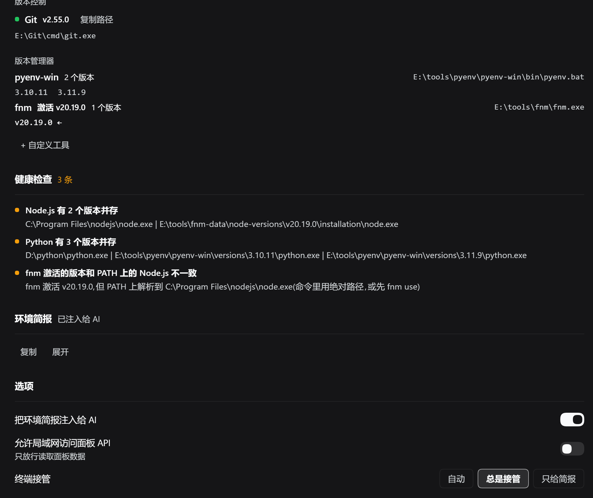

[English](README.en.md) | **中文**

# EnvDock · 环境码头

[](https://www.npmjs.com/package/dsh-envdock)
[](LICENSE)


> 让 AI 开口之前就知道：你的 Windows 上 Node / Python / Git 装在哪、该用哪个版本、这个终端里命令该怎么写。


Windows 上做开发，机器里常常并排放着好几套 Node / Python / Git，cmd、PowerShell、Git Bash 又各有各的语法。没有 EnvDock 时，AI 要先 `where node` 试探、猜路径、写错命令再重试——慢，而且容易在版本和语法上踩坑。

**EnvDock 是 DeepSeek Harness（dsh）的插件**：启动时把本机工具链探测清楚，把一份「环境简报」直接写进 AI 的上下文；需要时再接管命令工具，让 AI 用正确的终端语法干活。你不用填任何配置。

**适合谁**：在 Windows 上用 dsh 写代码的人；机器上装了多套 Node / Python / Git 的人；经常在 PowerShell、cmd、Git Bash 之间切换的人；希望 AI 少问「你用的哪个 node」的人。

**它不做什么**：不安装工具、不改系统 PATH、不替你决定版本——只负责把事实探清楚并告诉 AI。

## 为什么需要它

| 没有 EnvDock | 有 EnvDock |
|---|---|
| AI 每次都要 `where` / `Get-Command` 试探 | 简报里直接给绝对路径与版本 |
| 多版本并存，AI 猜不到你想用哪个 | 面板点一下设定默认版本 |
| 默认是 PowerShell，AI 却写 bash 语法 | 简报写明当前终端的语法要点 |
| `nvm use` / `fnm use` 与 PATH 不一致，问题难查 | 健康检查直接点出来 |
| 装了新工具要重启 dsh 才「看得见」 | 「重新探测」按系统当前 PATH 重扫 |

## 功能一览

- **工具链探测**：node、npm、pnpm、yarn、bun、deno、python、pip、uv、git、conda，列出**全部**候选路径与版本。
- **版本管理器探测**：nvm-windows、pyenv-win、conda、fnm、mise 会解析已装版本（前四还解析当前激活项）；Volta、asdf 只报「在场」，不猜输出格式。只有命令在 PATH 上或根目录真实存在才算在场。
- **默认版本一键切换**：多版本并存时，在面板里把某个绝对路径设为默认，AI 下一轮就按它来。
- **环境简报注入**：系统、默认终端、各工具绝对路径与版本、终端语法要点，一次写进运行上下文。
- **终端接管（可选）**：默认终端与宿主自带的命令工具不同族时，注册一个固定名字的 `envd_shell` 并隐藏宿主 shell；切换终端立即生效，不出现「没有命令工具」的空窗；宿主 shell 挡不掉的会话反过来让路，仍然只留一个命令工具。
- **健康检查**：应用商店占位符、失效的 PATH 目录、旧版本、npm/Node 不配套、版本管理器激活版本与 PATH 不一致等。
- **`envd` 工具**：让 AI 随时按名字解析工具（`resolve`）、取简报（`summary`）、查健康（`check`）、切换默认版本（`set_default`）。

## 安装

**前置条件**：Windows + 已安装 DeepSeek Harness（dsh）。插件以当前 profile 为单位安装，下面以 `web` 为例。

### 方式一：从 npm 安装（推荐）

```powershell
dsh plugin --profile web add dsh-envdock
```

安装后在插件页确认 EnvDock 已启用，然后重启 dsh。其他 profile 把 `web` 换成对应名字。

### 方式二：在 dsh 插件页安装（本地目录 / Git）

1. 打开 dsh 侧边栏的 **插件** 页。
2. 选择「安装」，填入插件来源，二选一：
   - 本地目录：`link:D:\plugins\envdock`（换成你的实际路径）
   - Git 地址：本仓库的 git URL
3. 确认 **EnvDock** 处于开启状态，然后重启 dsh。

### 方式三：命令行（本地目录）

```powershell
# 把插件装进 web profile；link: 后面是插件目录的绝对路径
dsh plugin --profile web add link:D:\plugins\envdock

# 重启 web
dsh web
```

安装后如果插件页里 EnvDock 没有自动启用，手动打开开关再重启。其他 profile（`tui`、`headless` 等）把 `web` 换成对应名字即可。

> 从源码使用：`git clone https://github.com/tkochj/dsh-envdock.git envdock`，再用上面的 `link:` 方式安装。源码改动需要重启 dsh 生效。

### 验证安装

- 侧边栏出现 **EnvDock** 入口，点开能看到默认终端与工具链。
- 新开会话时，AI 的上下文里会出现「本机环境 (EnvDock 实测,优先于猜测)」简报。
- 在对话里问 AI「我的 node 在哪」，它应该直接给出绝对路径，而不是现搜。

## 快速上手

1. **打开面板**：侧边栏 → EnvDock。
2. **看一眼探测结果**：工具链、版本管理器、健康检查。
3. **按需调整**：点「设为默认」选版本；点默认终端切 PowerShell / cmd / Git Bash。
4. **回到会话**：AI 已经拿到新的环境简报，直接干活。



## 面板导览

| 区域 | 作用 |
|---|---|
| **默认终端** | 在 PowerShell 7、Windows PowerShell、cmd、Git Bash 中选择，也可自定义终端（路径 + 名称 + 参数模板）。 |
| **命令工具** | 显示模型**实际拿到**的那个命令工具：宿主自带，或 EnvDock 已接管（并注明隐藏了哪些宿主 shell）。混合状态按会话汇总：「N 个会话用宿主工具」，悬停看逐会话终局。 |
| **宿主 PTY** | 仅作参考；它不是模型拿到的命令工具。 |
| **工具链** | 每个工具的当前默认路径与全部版本，可复制路径、设为默认。 |
| **版本管理器** | 在场才出现，含已装版本与激活项；一个都没有就明说没有。 |
| **健康检查** | 红 / 黄 / 灰三档，点开看原因与建议。 |
| **环境简报** | 面板里能预览 AI 实际拿到的那段文字，可复制、展开。 |
| **重新探测** | 按系统**当前** PATH 重扫（Windows 会重读注册表），删掉的失效目录不再报、新装工具立刻出现。 |
| **选项** | 简报注入、终端接管（自动 / 总是 / 只给简报）、允许局域网访问、自定义工具。 |

任何操作失败都会在面板顶部出现可关闭的错误条，不再静默吞掉。

## AI 看到什么

### 环境简报

插件会把类似下面的一段文字写进运行上下文（具体内容随机器变化）：

```text
## 本机环境 (EnvDock 实测,优先于猜测)
- 系统: Windows_NT 10.0.26300 (x64),用户 LAPTOP-XXXX
- 默认终端: Windows PowerShell → C:\Windows\System32\WindowsPowerShell\v1.0\powershell.exe (v5.1.26100)
  · 串联用 `;`,条件串联 `&&`/`||` 只有 PowerShell 7 支持
  · 环境变量 `$env:NAME`,调用外部程序要 `& $exe` 或用完整路径
  · 命令工具: `envd_shell`(EnvDock 已接管),里面只能写 Windows PowerShell 语法
- 工具(绝对路径,直接用,不必再 where/which):
  · Node.js v24.18.0 → C:\Program Files\nodejs\node.exe [另有 v20.19.0 ...]
  · Python v3.12.10 → D:\python\python.exe [...]
  · Git v2.55.0 → E:\Git\cmd\git.exe
- 版本管理器: pyenv-win(...) [2 个版本], fnm(...) [1 个版本,激活 v20.19.0]
- 未列出的工具仍可用 `envd` 工具按名字解析(resolve),不要用 where/which 反复试探。
```

### `envd` 工具

| action | 作用 | 何时用 |
|---|---|---|
| `summary`（默认） | 完整环境简报 | 想看 AI 拿到的原文 |
| `resolve` | 按名字返回默认路径、版本、全部候选、终端 | 需要精确路径或确认版本 |
| `check` | 返回健康问题清单 | 排查环境问题 |
| `set_default` | 把某个候选路径设为默认 | 切换版本 |

`resolve` 支持别名：`python` / `python3` / `py` 会命中同一条 Python 记录；`py.exe` 是启动器，结果里会单独说明 `py -3.10` 这类用法。

### 命令工具接管

- 宿主自带的命令工具是 `pwsh` / `bash` 等；当你的默认终端与它不是同一族时，EnvDock 会注册固定名字的 `envd_shell`，并隐藏宿主 shell，避免模型在两种语法之间猜。
- 与宿主同族时**什么都不做**，不会重复造工具。
- **沙箱按会话判，不按部署默认档判**：dsh 的执行器公布 `sandboxMode`（那是**部署默认档**），真实策略要逐会话 `sandboxPolicy.resolve({ session })`。只有本会话解析出 `danger-full-access` 时 EnvDock 才直接接管；一个会话被围栏不影响别的会话（`read-only` / `workspace-write` 的会话保留宿主命令工具）。
- **认得出 dsh-ops 的 `ops_bash`**（cordis 模式下顶替官方 shell）：它按 bash 家族参与接管判定，不会被漏认成「两个命令工具并列」。
- **宿主 shell 挡不掉的会话自动让路**：宿主把 `ops_bash` 这类工具注册在作用域私有层时，`restrict` 实测挡不掉它；EnvDock 反过来藏自己的 `envd_shell`，该会话只留宿主那一个命令工具。判定按**作用域**：官方 `pwsh` 全局注册、`ops_bash` 按会话发布时，每个会话只挡它自己真见过的宿主 shell，挡不掉的那个还在就让路——不会出现 `envd_shell` 与宿主工具并列。三种计划（遮挡宿主 / 让路 / 沙箱让路）互斥，任何会话都不会零工具。
- **工具表一变就立刻对账**（监听 `tools/change`，同一轮变更合并成一次）：别的插件晚一步注册或撤销 shell 时，遮挡是立即收敛，不用等 5 秒轮询。
- **被藏掉的命令工具直呼时给可操作拒绝**（`tools.guard`）：宿主 shell 被藏时告诉你「已由 EnvDock 接管，改用 `envd_shell`」；反过来，让路 / 沙箱会话里 `envd_shell` 被藏后仍被直呼时，会告诉你「改用宿主自带的那个 shell」。都不是没头没尾的 `UNKNOWN_TOOL`；替代工具在那个作用域不可见时守卫放行，绝不制造两个都调不到。
- 注册失败或被同名工具占用时，EnvDock 放弃接管并保留宿主工具，不会让你一个命令工具都没有。

## 设置与状态

配置保存在 `~/.dsh/envdock.json`（原子写入；损坏时自动备份为 `envdock.json.corrupt` 并回落到默认值）。

| 选项 | 默认 | 说明 |
|---|---|---|
| 简报注入 | 开 | 是否把环境简报写进 AI 上下文 |
| 终端接管 | 自动 | `自动`：不同族才接管；`总是接管`：强制接管；`只给简报`：不注册命令工具 |
| 沙箱下接管 | 委托执行 | 围栏会话里 EnvDock 自己的工具还没被摘掉时：`委托执行` 把命令经带围栏的宿主执行器转发（不绕过沙箱，这次调用的终端选择仍生效）；`直接拒绝` 一律报错。稳态围栏会话用的是宿主命令工具 |
| 允许局域网访问 | 关 | 面板 API 默认只放行本机 loopback；打开后局域网可读面板数据 |
| 自定义工具 | 空 | 补充 PATH 之外的工具 |

### 重置 / 卸载

```powershell
# 重置所有设置（默认终端、默认版本、选项）
Remove-Item ~/.dsh/envdock.json

# 卸载：在插件页移除 EnvDock，然后重启 dsh
```

删掉状态文件即回到全自动，不会影响其他插件。

## 常见问题

**为什么模型看到的是 `ops_bash` 而不是 `envd_shell`？**

命令工具是**逐会话**定终局的：同一台 dsh 里，不同会话的模型可能拿到不同的命令工具。看到 `ops_bash` 通常意味着 EnvDock 在这个会话里**让路**了，不是接管坏了。三种终局在面板上分别长这样：

| 终局 | 什么时候出现 | 模型手里 | 面板 |
|---|---|---|---|
| 直连接管（takeover） | 本会话无围栏，且宿主 shell 已被成功遮挡 | `envd_shell`（只能写默认终端的语法） | 全部会话都直连接管时挂「模型可见」；有其它终局时头部按会话汇总 |
| 让路（yield） | 宿主 shell 挂在作用域私有层，`restrict` 实测挡不掉（dsh-ops 的 cordis 模式就把 `ops_bash` 按会话挂） | 宿主那个工具（如 `ops_bash`） | 「N 个会话用宿主工具」 |
| 沙箱让路（sandbox-host） | 本会话的有效策略不是 `danger-full-access`（如 `workspace-write`） | 宿主带围栏的命令工具 | 「N 个会话用宿主工具」 |

让路时 EnvDock 反过来藏自己的 `envd_shell`，保证这个会话里只有一个命令工具；简报会直说：

```text
· 命令工具: `ops_bash`(宿主自带,用 bash / sh 语法);宿主 shell 在这个会话里挡不掉(作用域私有),EnvDock 的 `envd_shell` 已让路,直接用这个
```

三种计划互斥，任何会话都不会出现「两个都藏」（零命令工具）。另外两种情况同样不遮挡宿主工具：接管开关切到 **只给简报**，或 `envd_shell` 注册失败 / 被同名工具占用——宿主工具照常干活。

**面板头部说「N 个会话用宿主工具」是什么意思？**

EnvDock 逐会话对账，不搞「全局接管成功 / 失败」一刀切。N 是当前**没有走直连接管**的会话数——这些会话的模型拿到的是宿主自带的命令工具（原因见上一条：让路，或沙箱让路）。所以同一台机器上一部分会话用 `envd_shell`、一部分会话用宿主工具是正常状态，面板按会话说，才不会替这些会话说谎。

- 悬停这个 badge 能看到逐会话明细：会话 id 前 8 位 · 终局（直连接管 / 未接管 / 让路 / 沙箱让路）· 实际生效的工具名，以及接管诊断（注册 / 拆除 / 遮挡，委托 / 守卫拒绝 / 让路轮次等计数）。
- `/envdock-api` 的 `commandTool.scopes` 就是面板读的那份事实：`kind`、`tool`、`hostTool`（该会话里实际可见的宿主工具）、`hidden`（实际生效的遮挡）、`hidesOwn`、`confined`、`mode`。
- 没有这种会话时头部只挂「模型可见」的 ok badge（全是直连接管）。

**沙箱会话为什么没有 `envd_shell`？**

因为本会话解析出的有效策略不是 `danger-full-access`（例如 `workspace-write`）。EnvDock 自己的执行走 `ctx.subprocess`，那条路没有 `sandboxPolicy` 入口——自己 spawn 就等于绕过沙箱，所以围栏会话它不接管：藏掉 `envd_shell`，让模型用宿主自带、带围栏的命令工具。简报里的原话是：

```text
· 命令工具: `ops_bash`(宿主自带,用 bash / sh 语法);本会话被沙箱围栏(workspace-write):EnvDock 不接管(接管会绕过沙箱)
```

注意 `sandboxMode` 只是**部署默认档**：能力位（执行器会不会围栏）/ 部署默认 / 本会话有效策略是三层事实，最后一层逐会话问 `sandboxPolicy.resolve({ session })`。想在这个会话里也用 EnvDock 的终端，把会话权限切到 `danger-full-access`，下一次对账就接管（工具表变更时更快）；但如果宿主 shell 是作用域私有、`restrict` 挡不掉，即使无围栏也还是走让路，模型仍用宿主工具。

「沙箱下接管 → 委托执行」不是「围栏下也能用 EnvDock 终端」的开关：委托把命令经带围栏的宿主执行器转发（`resolve` + `execute`，命令走 `ENVD_CMD`，围栏挂在宿主进程上、子进程继承），它只在 `envd_shell` 还没从该会话工具表里摘掉的极短窗口（策略刚变严、对账还没跑到）才有意义——稳态下这个会话根本没有 `envd_shell`。

**装了但侧边栏没有 EnvDock？**
去插件页确认 EnvDock 已启用，并重启 dsh。用命令行安装时，确认 `add` 的是正确的 profile。

**接管后模型只能用一个 `envd_shell`，能力变少了？**
这是精简执行器的取舍：单次前台、输出截断、支持 `cwd` / `timeoutMs`，没有后台作业、tail 文件、`sandbox_permissions` 升级。把这些能力看得更重要时，在面板把「终端接管」切到 **只给简报**，宿主工具立刻回来。

**为什么面板说「本会话被沙箱围栏，EnvDock 不接管」？**
因为本会话的有效策略不是 `danger-full-access`（降级行为见上文「沙箱会话为什么没有 `envd_shell`」）。dsh 执行器公布的 `sandboxMode` 只是**部署默认档**，不代表你的会话真的被围栏——面板把「能力位 / 部署默认 / 本会话有效策略」三层分开写，逐会话策略在 `/envdock-api` 的 `sandbox.scopes` 里逐个给出。想让这个会话也用 EnvDock 的终端：把会话权限切到 `danger-full-access`，下一次对账就接管（工具表变更时更快）。

**健康检查说「版本管理器激活的版本和 PATH 不一致」？**
典型场景：`fnm` 激活了 v20，但 PATH 上的 `node` 仍解析到系统安装的 v24。按提示在命令里用绝对路径，或先 `fnm use` / `pyenv shell` 让 PATH 跟上。

**改了系统 PATH，面板还是旧的？**
点「重新探测」。Windows 上会重读机器级 + 用户级注册表；POSIX 或宿主没有 `subprocess` 服务时只能读 dsh 启动时的进程 PATH，需要重启 dsh。

**局域网打不开面板接口？**
默认只放行 loopback。在面板打开「允许局域网访问」；只有这个开关本身在局域网里也放行，避免 403 死循环。

**红黄灰三档健康检查各代表什么？**
红 = 错误（应用商店 Python 占位符、默认版本路径失效、默认终端不可用等）；黄 = 警告（多版本并存、版本过旧、PATH 有失效目录、版本管理器激活版本不一致等）；灰 = 提示（如 dsh 进程里的 PATH 是旧的）。

## 已知边界

- 探测的是**可执行文件与版本**，不解析 `.nvmrc` / `pyproject.toml` / `package.json` 里的版本要求。
- 版本探测依赖宿主的 `subprocess` 服务；没有它时只做 PATH 扫描，版本列显示「版本未知」。
- Volta / asdf 只报「在场」，不解析版本列表（输出格式随平台变，宁可不猜）。
- 接管后的命令工具是精简执行器（见上文），不提供后台作业等宿主 shell 的高级能力。
- 宿主把命令工具注册在作用域私有层时，`restrict` 挡不掉它：EnvDock 只能让路，该会话不出现 `envd_shell`（这不是配置项）。
- 工作目录取**当前会话的工作目录**，不是 dsh 进程的 cwd。
- 定位以 Windows 为主；PATH 分隔符、`PATHEXT`、`.cmd/.bat` 垫片、POSIX 终端目录等跨平台细节已处理，但 Windows 之外的探测能力弱于 Windows。
- 版本探测结果在内存中缓存 10 分钟（key 含 mtime + size）；升级二进制或切换版本会自然重测，「重新探测」会清空缓存。

更深的实现细节、设计取舍与自测说明见 [docs/DESIGN.md](https://github.com/tkochj/dsh-envdock/blob/main/docs/DESIGN.md)；各版本改了什么见 [CHANGELOG.md](https://github.com/tkochj/dsh-envdock/blob/main/CHANGELOG.md)。

## 开发

```
index.js          Host：探测、envd 工具、简报注入、终端接替、/envdock-api
client.js         Client：侧边栏图标 + 中央面板
cordis.patch.yml  bundle patch（insert id: envdock）
locale/           meta.title / meta.description（中英）
icon.svg          插件图标
CHANGELOG.md      版本变更记录
test/parsers.mjs        版本管理器输出解析自测
test/i18n-check.mjs     client.js 静态自检（词条/占位符/slot）
test/host-harness.mjs   Host 运行时夹具（替身服务，全链路）
docs/             设计文档与截图
```

```powershell
node test/parsers.mjs        # 版本管理器输出解析
node test/i18n-check.mjs     # 中英词条键/占位符一致、slot 注册仍在
node test/host-harness.mjs   # 用 Cordis 服务替身跑 apply()，覆盖所有 API op / envd action / 接管路径
```

欢迎 Issue / PR。提交前请保证三条自测全绿。

## 许可

[MIT](LICENSE) © 2026 EnvDock contributors
